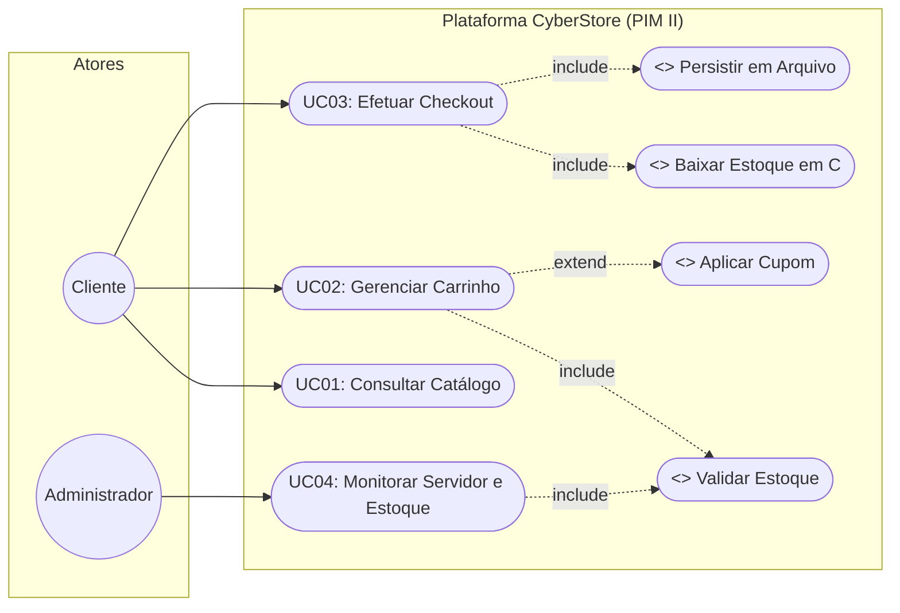
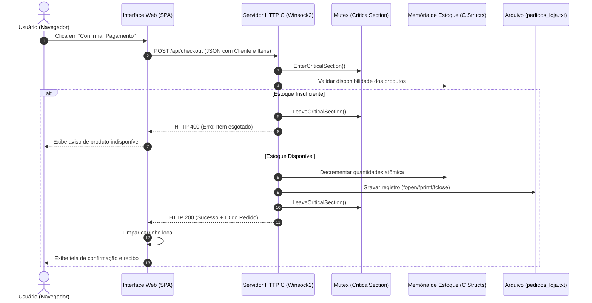

# ETAPA 3 – ENGENHARIA DE SOFTWARE ÁGIL (PROJETO PIM II - UNIP)
**Organização:** CyberHardware Comércio e Soluções em Tecnologia Ltda.  
**Sistema:** CyberStore / Plataforma de E-commerce de Hardware e Periféricos  
**Responsável:** Kenai (com integração para Saullo, Vittor Salvador, Vitor Godoy e Gabriel)

---

## 1. Introdução da Etapa
A presente etapa tem por objetivo documentar a especificação de engenharia de software da plataforma de e-commerce da *CyberHardware*, aplicando metodologias ágeis (Scrum/Kanban) em conjunto com a modelagem visual baseada na Unified Modeling Language (UML). A especificação aqui consolidada serve como contrato de requisitos para as etapas de modelagem de banco de dados (Etapa 4), implementação do backend em linguagem C estruturada (Etapa 5) e infraestrutura de redes cliente-servidor (Etapa 6).

---

## 2. Requisitos do Sistema

### 2.1. Requisitos Funcionais (RF)
Os Requisitos Funcionais definem as ações, fluxos de dados e comportamentos que o software deve executar.

| Código | Nome do Requisito | Descrição Detalhada | Prioridade |
| :---: | :--- | :--- | :---: |
| **RF01** | Gestão e Cadastro de Clientes | O sistema deve permitir que os clientes informem seus dados cadastrais (nome completo, CPF, e-mail, endereço de entrega e telefone) no fluxo de fechamento ou consulta de pedidos. | **Must Have** |
| **RF02** | Catálogo Dinâmico de Produtos | O sistema deve exibir produtos de hardware e periféricos organizados por categorias (*Placas de Vídeo*, *Processadores*, *Periféricos*, *Monitores*, *Armazenamento*), com preço original, preço promocional, estoque e ficha técnica. | **Must Have** |
| **RF03** | Controle Atômico de Estoque | O sistema deve verificar a disponibilidade física dos itens e realizar a baixa atômica e automática no estoque imediatamente após a confirmação do pedido, bloqueando compras excedentes. | **Must Have** |
| **RF04** | Gestão do Carrinho de Compras | O sistema deve permitir ao cliente adicionar itens, remover, alterar quantidades em tempo real e aplicar cupons promocionais de desconto (*TECH10*, *CYBER20*). | **Must Have** |
| **RF05** | Checkout e Formas de Pagamento | O sistema deve processar o fechamento da compra suportando múltiplas opções de pagamento: PIX (código copia-e-cola e simulação de QR Code), Cartão de Crédito (com parcelamento) e Boleto Bancário. | **Must Have** |
| **RF06** | Histórico e Telemetria de Pedidos | O sistema deve registrar de forma persistente cada venda aprovada, gerando código único de pedido e disponibilizando consulta ao histórico e telemetria operacional da aplicação. | **Should Have** |

---

### 2.2. Requisitos Não Funcionais (RNF)
Os Requisitos Não Funcionais especificam as propriedades de qualidade, restrições tecnológicas e conformidades regulatórias.

| Código | Categoria | Descrição Detalhada |
| :---: | :--- | :--- |
| **RNF01** | Segurança e LGPD | O sistema deve tratar dados pessoais dos clientes em estrita conformidade com a Lei Geral de Proteção de Dados (Lei nº 13.709/2018), aplicando mascaramento de dados sensíveis e não armazenando dados críticos de pagamento em texto puro. |
| **RNF02** | Desempenho e Latência | O tempo de resposta das requisições REST ao backend deve ser inferior a 100 milissegundos sob condições normais, viabilizado pela compilação nativa em linguagem C e sockets assíncronos. |
| **RNF03** | Acessibilidade Digital | A interface web deve seguir as diretrizes da WCAG 2.1 (Web Content Accessibility Guidelines) em nível AA, garantindo contraste cromático adequado, tags ARIA e suporte a leitores de tela. |
| **RNF04** | Concorrência e Integridade | O backend deve implementar exclusão mútua (`CRITICAL_SECTION` / Mutex) para garantir integridade transacional no decremento de estoque durante acessos simultâneos de múltiplos usuários. |
| **RNF05** | Portabilidade e Arquitetura | O sistema deve operar sob arquitetura desacoplada cliente-servidor (REST sobre HTTP/1.1), sendo compatível com os principais navegadores modernos (Chrome, Firefox, Edge) sem dependência de plugins externos. |
| **RNF06** | Persistência de Dados | O sistema deve assegurar a persistência dos dados transacionais em arquivos estruturados em disco (`pedidos_loja.txt`), projetado para integração com SGBD relacional normalizado na 3ª Forma Normal. |

---

## 3. Product Backlog Ágil (Metodologia Scrum com MoSCoW)

A equipe organizou o desenvolvimento da aplicação através de Histórias de Usuário (*User Stories*), pontuadas através da técnica de Planning Poker (sequência simplificada de Fibonacci) e priorizadas pela técnica MoSCoW (*Must Have, Should Have, Could Have, Won't Have*).

| ID | Épico | User Story (Como... Quero... Para...) | Prioridade | Estimativa | Critérios de Aceite (Definition of Done) |
|:---:|---|---|:---:|:---:|---|
| **US01** | Catálogo | Como **cliente**, quero visualizar os periféricos e hardwares organizados por categoria, para encontrar rapidamente o componente desejado. | **Must Have** | 5 pts | • Filtro por categoria funcionando. • Exibição de imagem, nome, preço e selo de estoque. • Modal de detalhes com especificações técnicas. |
| **US02** | Carrinho | Como **cliente**, quero adicionar, alterar quantidades e remover produtos da sacola, para gerenciar minha compra com flexibilidade. | **Must Have** | 5 pts | • Gaveta lateral interativa (slide-over). • Recálculo automático de subtotais. • Bloqueio de acréscimo se quantidade atingir estoque máximo. |
| **US03** | Estoque | Como **sistema**, quero decrementar automaticamente o estoque dos produtos na confirmação do pagamento, para evitar ruptura e vendas duplicadas. | **Must Have** | 8 pts | • Operação com controle de concorrência (Mutex em C). • Bloqueio transacional de item caso estoque seja 0. • Persistência imediata da quantidade atualizada. |
| **US04** | Checkout | Como **cliente**, quero preencher meus dados e escolher a forma de pagamento (PIX, Cartão ou Boleto), para concluir meu pedido com segurança. | **Must Have** | 8 pts | • Validação de campos obrigatórios (Nome, CPF, E-mail). • Geração de código PIX / Linha digitável de Boleto. • Retorno de tela de sucesso com número do pedido. |
| **US05** | Desconto | Como **cliente**, quero aplicar cupons promocionais válidos no carrinho, para usufruir de descontos percentuais no valor total. | **Should Have** | 3 pts | • Aceitação dos cupons `TECH10` (10%) e `CYBER20` (20%). • Recálculo do total com exibição clara do valor economizado. • Mensagem informativa caso cupom seja inválido. |
| **US06** | Histórico | Como **cliente/atendente**, quero consultar o histórico dos pedidos emitidos, para conferir comprovantes e dados da compra. | **Should Have** | 5 pts | • Listagem ordenada por data/hora decrescente. • Exibição dos itens adquiridos, valor total e status. • Leitura persistida do arquivo de pedidos. |
| **US07** | Admin | Como **administrador**, quero monitorar as métricas de tráfego e vendas do servidor em C, para verificar a saúde operacional da loja. | **Could Have** | 5 pts | • Modal com contadores de requisições e faturamento. • Indicador de status de conexão socket e uptime. • Resumo dos itens com estoque crítico. |

**Total de Story Points:** 39 pontos  
**Planejamento de Sprints (Ciclos de 1 semana):**
* **Sprint 1 (18 pts):** US01 (Catálogo - 5), US02 (Carrinho - 5), US03 (Controle de Estoque no backend C - 8). $\rightarrow$ *Entrega do MVP funcional de compra.*
* **Sprint 2 (16 pts):** US04 (Checkout e Pagamentos - 8), US05 (Cupons de Desconto - 3), US06 (Histórico e Persistência - 5). $\rightarrow$ *Entrega do fluxo financeiro e registros.*
* **Sprint 3 (5 pts):** US07 (Telemetria do Servidor e Relatórios Administrativos - 5) + Testes de Acessibilidade e Carga.

---

## 4. Modelagem Visual: Casos de Uso (UML)

### 4.1. Atores Identificados
* **Cliente:** Usuário final que navega no catálogo, adiciona periféricos ao carrinho, aplica cupons promocionais, preenche dados cadastrais e efetua pedidos de compra.
* **Administrador:** Responsável pela supervisão operacional, monitoramento de métricas do servidor em C, relatórios de faturamento e auditoria de estoque.

---

### 4.2. Especificação Textual Detalhada dos Casos de Uso

#### **UC01 – Consultar Catálogo de Hardware e Periféricos**
* **Ator Primário:** Cliente.
* **Pré-condição:** Acesso ao endereço da loja virtual via navegador web.
* **Pós-condição:** Lista de produtos exibida com preços atualizados e status de estoque.
* **Fluxo Principal:**
  1. O cliente acessa a página inicial do e-commerce.
  2. O sistema realiza requisição HTTP `GET /api/products` ao backend em C.
  3. O backend retorna a estrutura de produtos em formato JSON.
  4. O sistema renderiza os cartões de produtos com imagem, nome, valor e especificações.
  5. O cliente filtra os itens por categoria (*ex.: Placas de Vídeo*) ou digita termo de busca.
  6. O sistema atualiza dinamicamente a grade de exibição.

---

#### **UC02 – Gerenciar Carrinho de Compras**
* **Ator Primário:** Cliente.
* **Pré-condição:** Existência de pelo menos um produto disponível no catálogo.
* **Pós-condição:** Itens armazenados na sacola virtual com subtotais calculados.
* **Fluxo Principal:**
  1. O cliente clica no botão "Adicionar ao Carrinho" de um produto.
  2. O sistema valida se há estoque disponível para o item selecionado.
  3. O sistema adiciona o produto ao estado do carrinho e atualiza o badge numérico no cabeçalho.
  4. O cliente abre a gaveta do carrinho e pode incrementar/decrementar quantidades ou excluir itens.
  5. O sistema recalcula o subtotal, valor do frete e total geral.
* **Fluxo Alternativo (FA01 – Aplicação de Cupom):**
  1. O cliente insere o código `TECH10` ou `CYBER20` no campo de cupom e clica em "Aplicar".
  2. O sistema valida a regra do cupom e aplica o desconto percentual correspondente sobre os produtos.
* **Fluxo de Exceção (FE01 – Limite de Estoque Atingido):**
  1. O cliente tenta adicionar quantidade superior à disponível no estoque.
  2. O sistema bloqueia a ação e emite alerta visual de que a quantidade máxima foi atingida.

---

#### **UC03 – Efetuar Checkout e Concluir Pedido**
* **Ator Primário:** Cliente.
* **Pré-condição:** Carrinho contendo ao menos um item válido.
* **Pós-condição:** Pedido registrado no sistema, estoque decrementado e comprovante emitido.
* **Fluxo Principal:**
  1. O cliente clica em "Finalizar Pedido" na gaveta do carrinho.
  2. O sistema abre o modal de checkout solicitando dados do cliente (Nome, CPF, E-mail, Endereço).
  3. O cliente preenche os dados e escolhe a forma de pagamento (PIX, Cartão ou Boleto).
  4. O cliente confirma a transação clicando em "Confirmar Pagamento".
  5. O frontend envia requisição `POST /api/checkout` com o payload do pedido ao servidor em C.
  6. O servidor em C adquire o Mutex (`EnterCriticalSection`), verifica novamente a disponibilidade de estoque e realiza a baixa dos itens.
  7. O servidor formata o registro da venda e o grava no arquivo `pedidos_loja.txt`.
  8. O servidor libera o Mutex (`LeaveCriticalSection`) e responde com status HTTP 200 e número do pedido.
  9. A interface exibe a tela de confirmação e limpa o carrinho de compras.
* **Fluxo de Exceção (FE02 – Ruptura de Estoque Concorrente):**
  1. Durante a validação no backend, constata-se que outro usuário finalizou a compra do último item milissegundos antes.
  2. O backend retorna erro de estoque esgotado.
  3. A interface informa o cliente e solicita a atualização do carrinho.

---

#### **UC04 – Monitorar Telemetria e Controle de Estoque**
* **Ator Primário:** Administrador.
* **Pré-condição:** Servidor backend em execução.
* **Pós-condição:** Relatório operacional exibido na tela.
* **Fluxo Principal:**
  1. O administrador aciona a área de monitoramento técnico ("Servidor C").
  2. O frontend requisita `GET /api/stats` ao backend em C.
  3. O backend retorna métricas de tempo de atividade (uptime), total de requisições atendidas, pedidos faturados e volume financeiro total.
  4. O sistema renderiza os indicadores e a lista de alertas para produtos com estoque baixo.

---

### 4.3. Diagrama de Casos de Uso (UML)

---

## 5. Diagrama de Sequência UML: Fluxo Crítico de Compra e Baixa de Estoque

O diagrama de sequência a seguir ilustra a colaboração entre os módulos do sistema durante a realização de uma compra, evidenciando o papel do controle de concorrência no backend em C:

---

## 6. Rastreabilidade com as Demais Etapas do PIM II

Para garantir a coerência multidisciplinar exigida pela banca da UNIP, os artefatos desta Etapa 3 conectam-se diretamente com as outras frentes do trabalho:

1. **Conexão com a Etapa 4 (Modelagem de Banco de Dados - Saullo):**
   * Os requisitos **RF01, RF02 e RF05** derivam exatamente o Modelo Entidade-Relacionamento com as 5 entidades normalizadas: `CLIENTE`, `PRODUTO`, `CATEGORIA`, `PEDIDO` e `ITEM_PEDIDO`.
2. **Conexão com a Etapa 5 (Programação Estruturada em C - Vittor Salvador):**
   * As regras de negócio de **RF03, RNF02 e RNF04** são diretamente implementadas pelas structs `Product`, `Order` e pelas rotinas em C com `CRITICAL_SECTION` e `winsock2.h`.
3. **Conexão com a Etapa 6 (Redes e Nuvem - Vitor Godoy):**
   * O requisito **RNF05** fundamenta a arquitetura cliente-servidor HTTP/1.1 sobre a porta 8080 e desenha os requisitos de firewall e roteamento de rede.
4. **Conexão com a Etapa 7 (Direitos Humanos, LGPD e Acessibilidade - Gabriel):**
   * Os requisitos **RNF01 e RNF03** estabelecem a blindagem de privacidade por design (*Privacy by Design*) e a aderência aos padrões de inclusão WCAG 2.1.
