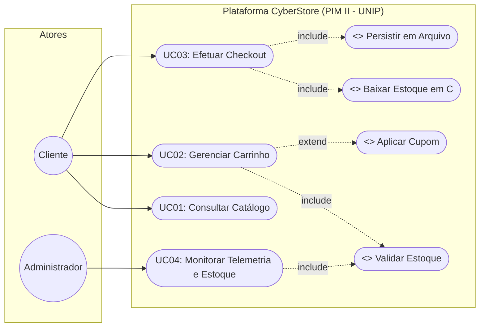
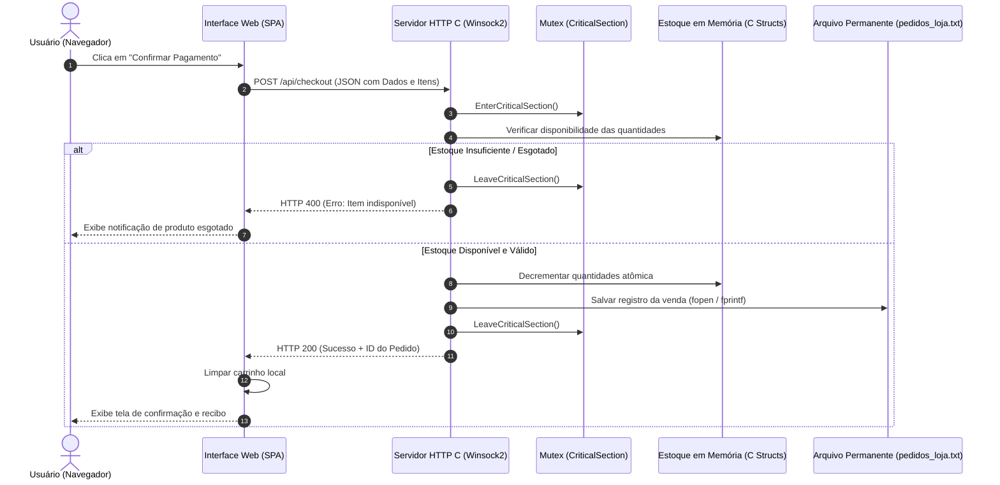

# ETAPA 3 – ENGENHARIA DE SOFTWARE ÁGIL
## PARTE 2: GABARITO TÉCNICO E RELATÓRIO OFICIAL PRONTO
**Projeto Integrado Multidisciplinar II (PIM II)**  
**Curso:** Curso Superior de Tecnologia em Análise e Desenvolvimento de Sistemas (UNIP)  
**Polo:** Mirassol – SP | Ano: 2026  
**Empresa Fictícia:** CyberHardware Comércio e Soluções em Tecnologia Ltda. (*CyberStore*)  
**Autor da Seção:** Kenai  
**Integração do Projeto:** Saullo, Vittor Salvador, Vitor Godoy, Gabriel e Cauê

---

## 1. Introdução e Contextualização do Projeto

A presente etapa documenta a especificação formal de Engenharia de Software da plataforma de comércio eletrônico desenvolvida para a **CyberHardware Comércio e Soluções em Tecnologia Ltda.** (nome fantasia *CyberStore*). O propósito primordial consiste em traduzir os objetivos de negócio da organização em especificações funcionais e técnicas rigorosas, operando como o elo de conexão que fundamenta a modelagem relacional de banco de dados (Etapa 4), a implementação do núcleo transacional e do servidor em linguagem C estruturada (Etapa 5), a infraestrutura de redes cliente-servidor (Etapa 6) e as diretrizes regulatórias de proteção de dados e inclusão digital (Etapa 7).

Diante da dinamicidade do mercado de varejo de hardware e periféricos de alta performance, optou-se pela condução do projeto por meio de um **framework ágil híbrido**, combinando a estrutura iterativa e incremental do **Scrum** com o controle de fluxo visual e contínuo do **Kanban**, associado à notação padronizada da **Unified Modeling Language (UML)** para a modelagem arquitetural.

---

## 2. Metodologia Ágil e Processo de Desenvolvimento

### 2.1. Framework Ágil Híbrido: Scrum e Kanban
Para compatibilizar a rigidez dos prazos acadêmicos com a necessidade de validação constante do código-fonte e dos artefatos de dados, a equipe adotou ciclos iterativos estruturados:
* **Sprints de Curta Duração (Time-box de 1 semana):** Permitiram entregas incrementais frequentes, reduzindo o custo de retrabalho e viabilizando a integração contínua entre a interface gráfica e o servidor nativo em C.
* **Quadro Kanban de Fluxo:** Utilizado para assegurar a visibilidade operacional do time, categorizando os itens em *Backlog*, *Em Análise*, *Em Desenvolvimento*, *Em Testes/Revisão* e *Concluído (Done)*, com limite de trabalho em progresso (WIP - *Work In Progress*) para evitar gargalos de integração.
* **Cerimônias Essenciais:**
  * *Sprint Planning:* Definição das metas da iteração e decomposição de épicos em tarefas técnicas.
  * *Daily Scrum:* Reuniões diárias de 15 minutos para alinhamento de impedimentos entre as disciplinas.
  * *Sprint Review & Retrospective:* Apresentação do incremento funcional (ex.: endpoints do servidor C respondendo na porta 8080) e refinamento do processo de trabalho da equipe.

### 2.2. Técnica de Priorização MoSCoW e Estimativa por Planning Poker
A hierarquização dos itens do backlog foi conduzida sob a técnica **MoSCoW**, categorizando as demandas em:
1. **Must Have (Obrigatório):** Itens vitais sem os quais o sistema não opera (catálogo, carrinho, checkout seguro e controle atômico de estoque).
2. **Should Have (Importante):** Recursos de alto valor agregado que complementam a experiência do usuário (cupons de desconto e histórico persistido de compras).
3. **Could Have (Desejável):** Funcionalidades de suporte operacional que não impedem a operação primária (painel de telemetria técnica e métricas do servidor em tempo real).
4. **Won't Have (Não contemplado nesta versão):** Funcionalidades postergadas para versões futuras (módulo de fidelidade gamificado e chat em tempo real com atendente).

O dimensionamento de esforço utilizou a dinâmica de **Planning Poker** baseada na sequência simplificada de Fibonacci (1, 2, 3, 5, 8 story points), correlacionando incerteza, complexidade algorítmica e tempo de implementação.

---

## 3. Levantamento e Especificação Formal de Requisitos

### 3.1. Requisitos Funcionais (RF)
Os Requisitos Funcionais especificam as funcionalidades ativas, regras de negócio e fluxos de dados processados pelo software:

| Código | Nome do Requisito | Descrição Detalhada da Funcionalidade | Prioridade |
| :---: | :--- | :--- | :---: |
| **RF01** | Gestão e Cadastro de Clientes | O sistema deve capturar os dados do cliente (Nome completo, CPF, e-mail, telefone e endereço de entrega) no fluxo de fechamento do pedido, assegurando dados mínimos para emissão e remessa. | **Must Have** |
| **RF02** | Catálogo Dinâmico de Produtos | O sistema deve disponibilizar o catálogo de periféricos e peças organizado por categorias (*Placas de Vídeo*, *Processadores*, *Periféricos*, *Monitores*, *Armazenamento*), exibindo preço original, preço promocional, estoque disponível e especificações. | **Must Have** |
| **RF03** | Controle Atômico de Estoque | O sistema deve validar a disponibilidade física dos componentes e realizar o decremento automático e atômico no estoque imediatamente após a confirmação da transação, impedindo vendas em duplicidade (*overselling*). | **Must Have** |
| **RF04** | Gestão de Carrinho e Cupons | O sistema deve permitir ao cliente adicionar itens, remover, alterar quantidades em tempo real e aplicar cupons promocionais de desconto (*TECH10*, *CYBER20*), recalculando os totais instantaneamente. | **Must Have** |
| **RF05** | Checkout e Formas de Pagamento | O sistema deve processar a finalização da compra oferecendo suporte a múltiplas modalidades: PIX (código copia-e-cola e simulador de QR Code), Cartão de Crédito (com parcelamento) e Boleto Bancário. | **Must Have** |
| **RF06** | Histórico e Telemetria de Pedidos | O sistema deve registrar de maneira persistente cada venda confirmada, gerando código único identificador do pedido e disponibilizando consulta ao histórico de transações e estatísticas da aplicação. | **Should Have** |

### 3.2. Requisitos Não Funcionais (RNF)
Os Requisitos Não Funcionais estabelecem os padrões de qualidade, diretrizes de segurança, arquitetura e desempenho operacional:

| Código | Categoria | Descrição Detalhada da Restrição de Qualidade |
| :---: | :--- | :--- |
| **RNF01** | Segurança e LGPD | O sistema deve tratar dados pessoais dos clientes em estrita observância à Lei Geral de Proteção de Dados (Lei nº 13.709/2018), aplicando mascaramento de dados sensíveis e trafegando credenciais de forma cifrada. |
| **RNF02** | Desempenho e Latência | O tempo de resposta das requisições HTTP REST processadas pelo backend deve ser estritamente inferior a 100 milissegundos em condições normais, viabilizado pela compilação nativa em linguagem C e Winsock2. |
| **RNF03** | Acessibilidade Digital | A interface web deve seguir as diretrizes da WCAG 2.1 nível AA e ABNT NBR 17225:2025, garantindo navegação completa por teclado, contraste cromático mínimo de 4.5:1, semântica ARIA e suporte a leitores de tela. |
| **RNF04** | Concorrência e Integridade | O backend deve implementar controle de exclusão mútua (`CRITICAL_SECTION` / Mutex) para garantir atomicidade transacional e integridade de memória durante o decremento simultâneo de estoque por múltiplos clientes. |
| **RNF05** | Arquitetura e Interoperabilidade | O sistema deve operar sob arquitetura desacoplada cliente-servidor (REST sobre HTTP/1.1 com payloads em JSON), garantindo interoperabilidade total com navegadores modernos sem necessidade de plugins externos. |
| **RNF06** | Persistência de Dados | O sistema deve garantir a durabilidade dos dados transacionais em disco (`pedidos_loja.txt`), estruturado de forma perfeitamente compatível com o Modelo Relacional normalizado na 3ª Forma Normal. |

---

## 4. Product Backlog Ágil e Planejamento de Sprints

### 4.1. Tabela do Product Backlog com Critérios de Aceite (DoD)
A tabela a seguir consolida as Histórias de Usuário (*User Stories*), sua prioridade no método MoSCoW, estimativa em Story Points e Critérios de Aceite (*Definition of Done*):

| ID | Épico | User Story (Como... Quero... Para...) | Prioridade | Estimativa | Critérios de Aceite (Definition of Done) |
| :---: | :--- | :--- | :---: | :---: | :--- |
| **US01** | Catálogo | Como **cliente**, quero navegar pelos periféricos e peças filtrando por categoria, para localizar rapidamente o item que desejo comprar. | **Must Have** | 5 pts | • Filtros de hardware responsivos. • Exibição de imagem, nome, valor à vista e selo de estoque. • Modal de detalhes com ficha técnica do fabricante. |
| **US02** | Carrinho | Como **cliente**, quero gerenciar minha sacola de compras alterando quantidades e removendo itens, para organizar meu pedido com facilidade. | **Must Have** | 5 pts | • Painel lateral deslizante (*slide-over*). • Recálculo automático de subtotais e frete. • Bloqueio visual caso a quantidade atinja o limite físico em estoque. |
| **US03** | Estoque | Como **sistema**, quero decrementar atomicamente o estoque na confirmação do pedido, para garantir a consistência dos produtos disponíveis. | **Must Have** | 8 pts | • Bloqueio transacional concorrente via Mutex em C. • Validação prévia de saldo (quantidade $\ge$ 1). • Persistência em disco imediatamente após a baixa. |
| **US04** | Checkout | Como **cliente**, quero informar meus dados e escolher o método de pagamento (PIX, Cartão ou Boleto), para concluir minha compra com segurança. | **Must Have** | 8 pts | • Validação de campos obrigatórios (Nome, CPF, E-mail). • Geração de código copia-e-cola PIX / Linha digitável. • Exibição de modal de confirmação com ID do pedido. |
| **US05** | Desconto | Como **cliente**, quero aplicar cupons promocionais válidos no carrinho, para obter descontos percentuais no valor final. | **Should Have** | 3 pts | • Suporte validado aos cupons `TECH10` (10%) e `CYBER20` (20%). • Demonstração clara da economia na discriminação do total. • Mensagem de erro amigável para códigos inválidos. |
| **US06** | Histórico | Como **cliente/atendente**, quero visualizar os pedidos concluídos, para emitir comprovantes e acompanhar compras anteriores. | **Should Have** | 5 pts | • Listagem ordenada cronologicamente. • Apresentação do valor total, forma de pagamento e status. • Leitura resiliente a partir do arquivo persistido. |
| **US07** | Telemetria | Como **administrador**, quero acompanhar as métricas operacionais do servidor, para auditar requisições e a saúde da loja. | **Could Have** | 5 pts | • Painel com contadores de requisições, pedidos e faturamento. • Monitoramento de uptime do processo em C. • Sinalização de componentes em nível crítico de estoque. |

**Carga Total do Projeto:** **39 Story Points**.

### 4.2. Estratégia de Distribuição das Sprints
1. **Sprint 1 – Núcleo de Catálogo e Estoque (18 Story Points):**
   * *Escopo:* Implementação de US01, US02 e US03.
   * *Meta da Sprint:* Entregar o MVP funcional capaz de renderizar produtos e validar a integridade de estoque em memória.
2. **Sprint 2 – Transações Financeiras e Checkout (16 Story Points):**
   * *Escopo:* Implementação de US04, US05 e US06.
   * *Meta da Sprint:* Disponibilizar o fluxo completo de compra, cálculo de cupons e persistência transacional em arquivo.
3. **Sprint 3 – Telemetria, Acessibilidade e Estabilização (5 Story Points):**
   * *Escopo:* Implementação de US07, auditoria de acessibilidade WCAG 2.1 AA e testes de carga sob o protocolo HTTP/1.1.
   * *Meta da Sprint:* Homologação final da aplicação e preparação dos artefatos da monografia.

---

## 5. Modelagem Visual com Unified Modeling Language (UML)

### 5.1. Identificação dos Atores do Sistema
* **Cliente:** Usuário final que interage com a loja virtual via navegador web para consultar produtos, simular compras, gerenciar itens no carrinho, aplicar benefícios promocionais e finalizar transações comerciais.
* **Administrador:** Responsável pela manutenção e auditoria técnica da plataforma, com privilégios para acessar estatísticas operacionais de tráfego, telemetria do processo executável em C e histórico consolidado de pedidos.

---

### 5.2. Especificação Textual Detalhada dos Casos de Uso

#### **UC01 – Consultar Catálogo de Hardware e Periféricos**
* **Ator Primário:** Cliente.
* **Pré-condição:** Acesso à aplicação web por meio de navegador compatível conectado à rede.
* **Pós-condição:** Catálogo exibido dinamicamente com preços, categorias e estoques atualizados.
* **Fluxo Principal:**
  1. O cliente acessa o endereço da plataforma *CyberStore*.
  2. O frontend despacha uma requisição HTTP `GET /api/products` ao backend em C.
  3. O servidor em C recupera os dados de catálogo da memória persistida e retorna o array estruturado em JSON.
  4. A interface web processa a resposta e renderiza os cartões de produtos.
  5. O cliente seleciona filtros por categoria de interesse (*ex.: Monitores*) ou digita no campo de busca.
  6. A visualização é atualizada em tempo real conforme os critérios definidos.

---

#### **UC02 – Gerenciar Carrinho de Compras**
* **Ator Primário:** Cliente.
* **Pré-condição:** Pelo menos um produto ativo e disponível no catálogo da loja.
* **Pós-condição:** Carrinho de compras atualizado e totalizadores recalculados.
* **Fluxo Principal:**
  1. O cliente aciona o comando "Adicionar" no cartão de um componente.
  2. O sistema verifica se a quantidade desejada não supera a disponibilidade física do item.
  3. O item é inserido na estrutura do carrinho e o indicador visual do cabeçalho é incrementado.
  4. O cliente abre a gaveta lateral (*slide-over*) para ajustar quantidades ou remover itens.
  5. O sistema recalcula dinamicamente os valores de subtotal, frete e total final.
* **Fluxo Alternativo (FA01 – Aplicação de Cupom de Desconto):**
  1. No painel do carrinho, o cliente insere o código `TECH10` ou `CYBER20` e aciona "Aplicar".
  2. O sistema valida as regras do cupom promocional e abate o percentual correspondente do subtotal.
  3. A interface discrimina o desconto concedido e exibe o novo montante líquido a pagar.
* **Fluxo de Exceção (FE01 – Quantidade Excede Disponibilidade):**
  1. O cliente tenta adicionar unidade excedente de um item com estoque limitado.
  2. O sistema interrompe a ação, emite notificação informativa de limite atingido e impede a adição.

---

#### **UC03 – Efetuar Checkout e Concluir Pedido**
* **Ator Primário:** Cliente.
* **Pré-condição:** Existência de ao menos um item válido na sacola de compras.
* **Pós-condição:** Pedido persistido em disco, estoque baixado e comprovante transacional emitido.
* **Fluxo Principal:**
  1. O cliente aciona o botão "Finalizar Pedido" no painel do carrinho.
  2. O sistema apresenta o formulário de checkout solicitando dados cadastrais (Nome, CPF, E-mail, Endereço).
  3. O cliente preenche os dados e opta por uma modalidade de pagamento (PIX, Cartão ou Boleto).
  4. O cliente confirma a transação acionando o botão "Confirmar Pagamento".
  5. O frontend envia requisição HTTP `POST /api/checkout` contendo os dados do cliente e os itens comprados.
  6. O backend em C adquire o Mutex (`EnterCriticalSection`) para garantir isolamento e concorrência segura.
  7. O backend revalida os saldos de estoque e efetua o decremento atômico de cada produto.
  8. O backend formata o registro da venda e o salva no arquivo permanente `pedidos_loja.txt`.
  9. O backend libera o Mutex (`LeaveCriticalSection`) e devolve status HTTP 200 com o ID único gerado.
  10. A interface web limpa a sacola de compras e exibe o comprovante de pagamento ao cliente.
* **Fluxo de Exceção (FE02 – Ruptura de Estoque Concorrente):**
  1. Durante a checagem no backend sob Mutex, detecta-se que outro usuário adquiriu a última unidade instantes antes.
  2. O backend responde com erro HTTP 400 indicando indisponibilidade do item.
  3. A interface alerta o cliente sobre o esgotamento do produto e solicita reajuste no carrinho.

---

#### **UC04 – Monitorar Telemetria Operacional e Estoque**
* **Ator Primário:** Administrador.
* **Pré-condição:** Servidor nativo em C em execução na porta configurada (8080).
* **Pós-condição:** Métricas de desempenho, uptime e vendas exibidas em painel analítico.
* **Fluxo Principal:**
  1. O administrador aciona o botão de auditoria técnica ("Servidor C") na interface.
  2. A interface despacha requisição HTTP `GET /api/stats` ao servidor backend.
  3. O backend retorna as métricas consolidadas: tempo em execução (uptime), total de requisições atendidas, pedidos finalizados e receita total gerada.
  4. A interface renderiza os indicadores em tempo real e sinaliza os itens que demandam reposição urgente.

---

### 5.3. Diagrama de Casos de Uso UML

O diagrama a seguir sintetiza as interações entre os atores do sistema e os casos de uso, evidenciando as relações de dependência obrigatória (`<<include>>`) e extensão opcional (`<<extend>>`):

---

### 5.4. Diagrama de Sequência UML: Fluxo Crítico de Compra e Decremento de Estoque

O diagrama de sequência demonstra a colaboração temporal e a troca assíncrona de mensagens entre os subsistemas durante a etapa mais sensível do e-commerce, destacando o papel da sincronização de threads e da persistência em disco:

---

## 6. Rastreabilidade Multidisciplinar Integrada

Para evidenciar a robustez metodológica do projeto frente às exigências da banca da UNIP, a especificação de software desta Etapa 3 estabelece conexão direta com as demais áreas do PIM II:

1. **Integração com a Etapa 4 (Banco de Dados – Saullo):**  
   Os requisitos funcionais **RF01, RF02 e RF05** serviram de insumo direto para a elaboração do Modelo Entidade-Relacionamento (DER/MER) e para a normalização relacional até a 3ª Forma Normal, modelando as entidades `CLIENTE`, `PRODUTO`, `CATEGORIA`, `PEDIDO` e `ITEM_PEDIDO`.
2. **Integração com a Etapa 5 (Programação Estruturada em C – Vittor Salvador):**  
   Os requisitos **RF03, RNF02 e RNF04** ditaram o desenvolvimento do backend nativo em linguagem C: structs tipadas (`Product`, `Order`), persistência de arquivos via `FILE*` e uso de seções críticas de sincronização (`CRITICAL_SECTION`) sobre Sockets TCP Winsock2.
3. **Integração com a Etapa 6 (Redes e Sistemas Distribuídos – Vitor Godoy):**  
   Os requisitos **RNF02 e RNF05** definiram o protocolo de aplicação HTTP/1.1 sobre a porta 8080, orientando a topologia de rede local, o endereçamento IP e as regras de firewall necessárias para comunicação segura entre cliente e servidor.
4. **Integração com a Etapa 7 (LGPD, Segurança e Inclusão – Gabriel):**  
   Os requisitos **RNF01 e RNF03** orientaram a blindagem de privacidade de dados desde a concepção (*Privacy by Design*) e a total conformidade visual aos padrões internacionais de acessibilidade (WCAG 2.1 nível AA e ABNT NBR 17225:2025).

---

## 7. Referências Bibliográficas (ABNT NBR 6023:2018)

* LARMAN, Craig. **Utilizando UML e Padrões:** uma introdução à análise e ao projeto orientados a objetos e ao desenvolvimento iterativo. 3. ed. Porto Alegre: Bookman, 2007.
* MARTIN, Robert C. **Clean Code:** A Handbook of Agile Software Craftsmanship. Upper Saddle River: Prentice Hall, 2008.
* PRESSMAN, Roger S.; MAXIM, Bruce R. **Engenharia de Software:** uma abordagem profissional. 9. ed. Porto Alegre: AMGH, 2021.
* SCHWABER, Ken; SUTHERLAND, Jeff. **O Guia do Scrum:** as regras do jogo. Scrum.org, 2020. Disponível em: <https://scrumguides.org/>. Acesso em: 08 nov. 2026.
* SOMMERVILLE, Ian. **Engenharia de Software**. 10. ed. São Paulo: Pearson Education do Brasil, 2019.
* W3C. **Web Content Accessibility Guidelines (WCAG) 2.1**. World Wide Web Consortium, 2018. Disponível em: <https://www.w3.org/TR/WCAG21/>. Acesso em: 08 nov. 2026.
