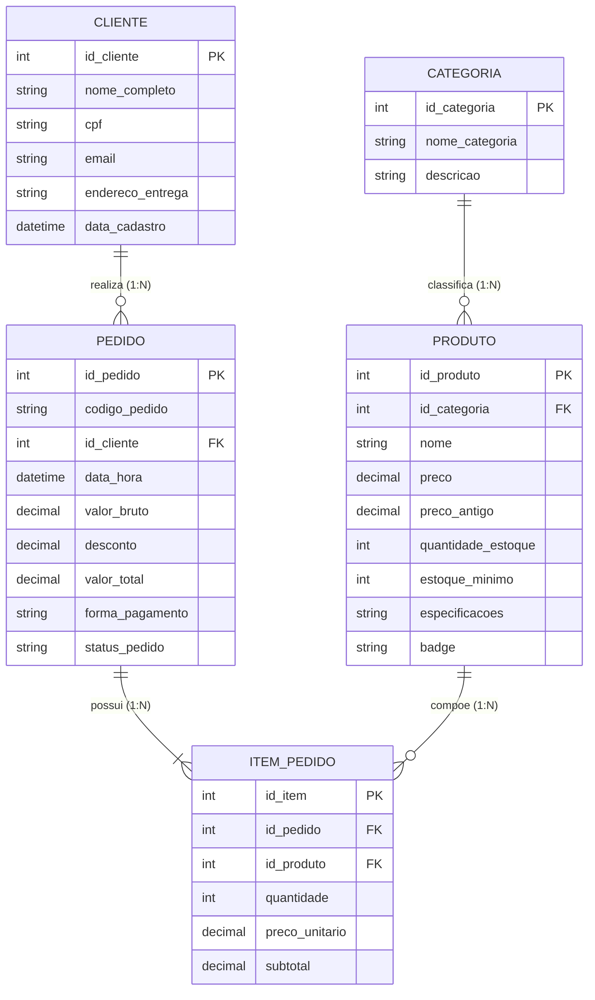

# ETAPA 4: BANCO DE DADOS — PARTE 2: GABARITO DE REFERÊNCIA E SCRIPTS PRONTOS
**Destinatário:** Saullo (Gabarito / Solução de Referência da Etapa 4)  
**Projeto:** PIM II – CST em Análise e Desenvolvimento de Sistemas (UNIP 2026/2)  
**Organização:** CyberHardware Comércio e Soluções em Tecnologia Ltda.  
**Objetivo deste Documento:** Disponibilizar o modelo conceitual, DER visual, modelo lógico normalizado, scripts SQL completos e texto comparativo NoSQL já testados e 100% integrados ao sistema.

---

## 📊 1. Diagrama Entidade-Relacionamento (DER em Mermaid)

Você pode visualizar este diagrama diretamente ou exportar para imagem/desenhar no seu software de modelagem (brModelo / Draw.io):



---

## 📐 2. Fundamentação da Normalização (Texto Oficial para o Relatório)

Para comprovar o rigor acadêmico perante a banca da UNIP, o modelo passou pelo processo formal de normalização de dados:

### 1ª Forma Normal (1FN):
* **Regra:** Uma tabela está na 1FN quando todos os atributos contêm apenas valores atômicos (indivisíveis) e não existem grupos repetidores ou atributos multivalorados.
* **Aplicação no Projeto:** 
  * A relação entre `PEDIDO` e `PRODUTO` não foi armazenada em uma lista de strings dentro da tabela `PEDIDO`. 
  * Criou-se a tabela associativa `ITEM_PEDIDO`, onde cada linha armazena exclusivamente um item individualizado, com sua respectiva quantidade e valor unitário atômico.

### 2ª Forma Normal (2FN):
* **Regra:** Uma tabela está na 2FN quando já atende à 1FN e todos os atributos não-chave dependem funcionalmente de forma total da Chave Primária (inexistência de dependência parcial).
* **Aplicação no Projeto:**
  * Todas as tabelas do projeto utilizam chaves primárias simples e unívocas (`id_categoria`, `id_produto`, `id_cliente`, `id_pedido`, `id_item`).
  * Em `ITEM_PEDIDO`, os atributos `quantidade`, `preco_unitario` e `subtotal` dependem diretamente da identificação do item, sem dependência parcial.

### 3ª Forma Normal (3FN):
* **Regra:** Uma tabela está na 3FN quando já atende à 2FN e nenhum atributo não-chave depende de outro atributo não-chave (inexistência de dependência transitiva).
* **Aplicação no Projeto:**
  * As descrições das categorias não foram duplicadas dentro da tabela `PRODUTO`; criou-se a tabela `CATEGORIA`, eliminando redundâncias.
  * O endereço do cliente não foi repetido nos pedidos; apenas o `id_cliente` é referenciado como Chave Estrangeira.
  * O desconto e o valor total pertencem à transação do pedido, garantindo que o esquema relacional esteja livre de anomalias de inserção, atualização ou exclusão.

---

## 💻 3. Scripts SQL Prontos (DDL e DML)

Estes scripts estão testados e prontos para execução em MySQL Workbench, DBeaver, MariaDB ou PostgreSQL:

### Script DDL: Criação do Banco e Estrutura das Tabelas
```sql
-- Criação da base de dados com charset UTF-8 completo
CREATE DATABASE IF NOT EXISTS cyberhardware_db
CHARACTER SET utf8mb4 COLLATE utf8mb4_unicode_ci;

USE cyberhardware_db;

-- 1. Tabela CATEGORIA
CREATE TABLE IF NOT EXISTS CATEGORIA (
    id_categoria INT AUTO_INCREMENT PRIMARY KEY,
    nome_categoria VARCHAR(50) NOT NULL UNIQUE,
    descricao VARCHAR(200)
) ENGINE=InnoDB;

-- 2. Tabela PRODUTO
CREATE TABLE IF NOT EXISTS PRODUTO (
    id_produto INT AUTO_INCREMENT PRIMARY KEY,
    id_categoria INT NOT NULL,
    nome VARCHAR(100) NOT NULL,
    preco DECIMAL(10,2) NOT NULL,
    preco_antigo DECIMAL(10,2),
    quantidade_estoque INT NOT NULL DEFAULT 0,
    estoque_minimo INT NOT NULL DEFAULT 2,
    especificacoes VARCHAR(200),
    badge VARCHAR(30) DEFAULT 'Normal',
    CONSTRAINT chk_preco_positivo CHECK (preco > 0),
    CONSTRAINT chk_estoque_nao_negativo CHECK (quantidade_estoque >= 0),
    CONSTRAINT fk_produto_categoria FOREIGN KEY (id_categoria) 
        REFERENCES CATEGORIA(id_categoria) 
        ON UPDATE CASCADE 
        ON DELETE RESTRICT
) ENGINE=InnoDB;

-- 3. Tabela CLIENTE (Aderente à LGPD)
CREATE TABLE IF NOT EXISTS CLIENTE (
    id_cliente INT AUTO_INCREMENT PRIMARY KEY,
    nome_completo VARCHAR(100) NOT NULL,
    cpf VARCHAR(14) NOT NULL UNIQUE,
    email VARCHAR(100) NOT NULL UNIQUE,
    endereco_entrega VARCHAR(150) NOT NULL,
    data_cadastro TIMESTAMP DEFAULT CURRENT_TIMESTAMP
) ENGINE=InnoDB;

-- 4. Tabela PEDIDO
CREATE TABLE IF NOT EXISTS PEDIDO (
    id_pedido INT AUTO_INCREMENT PRIMARY KEY,
    codigo_pedido VARCHAR(20) NOT NULL UNIQUE,
    id_cliente INT NOT NULL,
    data_hora TIMESTAMP DEFAULT CURRENT_TIMESTAMP,
    valor_bruto DECIMAL(10,2) NOT NULL,
    desconto DECIMAL(10,2) DEFAULT 0.00,
    valor_total DECIMAL(10,2) NOT NULL,
    forma_pagamento VARCHAR(30) NOT NULL,
    status_pedido VARCHAR(20) NOT NULL DEFAULT 'Aprovado',
    CONSTRAINT fk_pedido_cliente FOREIGN KEY (id_cliente) 
        REFERENCES CLIENTE(id_cliente)
        ON UPDATE CASCADE 
        ON DELETE RESTRICT
) ENGINE=InnoDB;

-- 5. Tabela ITEM_PEDIDO (Associativa N:N)
CREATE TABLE IF NOT EXISTS ITEM_PEDIDO (
    id_item INT AUTO_INCREMENT PRIMARY KEY,
    id_pedido INT NOT NULL,
    id_produto INT NOT NULL,
    quantidade INT NOT NULL,
    preco_unitario DECIMAL(10,2) NOT NULL,
    subtotal DECIMAL(10,2) NOT NULL,
    CONSTRAINT chk_qtd_item CHECK (quantidade > 0),
    CONSTRAINT fk_item_pedido FOREIGN KEY (id_pedido) 
        REFERENCES PEDIDO(id_pedido) 
        ON DELETE CASCADE,
    CONSTRAINT fk_item_produto FOREIGN KEY (id_produto) 
        REFERENCES PRODUTO(id_produto)
        ON UPDATE CASCADE 
        ON DELETE RESTRICT
) ENGINE=InnoDB;
```

### Script DML: Carga Inicial de Dados (Idêntica ao Sistema em C)
```sql
-- Inserção das Categorias Oficiais
INSERT INTO CATEGORIA (id_categoria, nome_categoria, descricao) VALUES
(1, 'Placas de Video', 'Placas graficas de alto desempenho e Ray Tracing'),
(2, 'Processadores', 'CPUs multicore para jogos e estacoes de trabalho'),
(3, 'Perifericos', 'Teclados mecanicos, mouses e fones gamer'),
(4, 'Monitores', 'Monitores de alta taxa de atualizacao e resposta rapida'),
(5, 'Armazenamento', 'SSDs NVMe M.2 Gen4 de altissima velocidade');

-- Inserção dos Produtos do E-commerce
INSERT INTO PRODUTO (id_produto, id_categoria, nome, preco, preco_antigo, quantidade_estoque, estoque_minimo, especificacoes, badge) VALUES
(1, 1, 'Placa de Video RTX 4080 Super 16GB', 7299.90, 8199.00, 5, 2, '16GB GDDR6X | 256-bit | Tri-Fan', 'Destaque'),
(2, 2, 'Processador AMD Ryzen 7 7800X3D', 2899.00, 3299.00, 8, 3, '8 Cores / 16 Threads | 104MB Cache', 'Mais Vendido'),
(3, 3, 'Teclado Mecanico RGB Switch Red', 349.90, 429.00, 15, 5, 'Anti-Ghosting | Switch Red Linear', 'Oferta'),
(4, 3, 'Mouse Gamer Sem Fio 26000 DPI', 299.90, 389.00, 12, 4, 'Sensor Optico 26K | Peso 58g', 'Novo'),
(5, 4, 'Monitor Gamer 27" IPS 165Hz 1ms', 1499.00, 1799.00, 6, 2, '27 pol | IPS | 165Hz | HDR', 'Popular'),
(6, 5, 'SSD NVMe M.2 2TB Gen4 7000MB/s', 899.90, 1099.00, 10, 3, 'PCIe 4.0 | Leitura 7000MB/s', 'Alta Velocidade');

-- Inserção de Cliente de Teste
INSERT INTO CLIENTE (id_cliente, nome_completo, cpf, email, endereco_entrega) VALUES
(1, 'Vittor Salvador de Oliveira', '123.456.789-00', 'vittor@cyberhardware.com.br', 'Av. Paulista, 1842, Bela Vista - Sao Paulo/SP');

-- Inserção de Pedido de Demonstração
INSERT INTO PEDIDO (id_pedido, codigo_pedido, id_cliente, valor_bruto, desconto, valor_total, forma_pagamento, status_pedido) VALUES
(1, 'PED-00001', 1, 7299.90, 0.00, 7299.90, 'PIX', 'Aprovado');

-- Inserção do Item do Pedido
INSERT INTO ITEM_PEDIDO (id_item, id_pedido, id_produto, quantidade, preco_unitario, subtotal) VALUES
(1, 1, 1, 1, 7299.90, 7299.90);
```

---

## 🔄 4. Análise e Comparativo Técnico: SQL vs. NoSQL

Texto para a seção teórica exigida pela UNIP:

> "Para a plataforma de e-commerce da *CyberHardware*, optou-se prioritariamente por um **Sistema Gerenciador de Banco de Dados Relacional (SGBD-R)** como MySQL ou PostgreSQL devido à necessidade imperiosa de conformidade com os princípios **ACID** (*Atomicidade, Consistência, Isolamento e Durabilidade*). No contexto de comércio eletrônico de hardware, a integridade transacional é prioritária: uma venda jamais pode ser confirmada sem a garantia de baixa atômica de estoque, prevenindo o problema clássico de ruptura (venda duplicada de itens sem saldo físico).
> 
> Contudo, em uma perspectiva de arquitetura escalável e distribuída, a organização propõe uma abordagem de **Persistência Poliglota**, integrando um banco **Não-Relacional (NoSQL)**:
> 1. **Armazenamento Chave-Valor (Redis):** Recomendado para armazenamento em memória (*in-memory*) das sessões ativas de navegação e do carrinho de compras dos clientes. Proporciona tempos de leitura e escrita inferiores a 5 milissegundos, desonerando o banco relacional principal de requisições voláteis.
> 2. **Base de Documentos (MongoDB):** Recomendada para o catálogo expandido de especificações técnicas dos componentes de informática, permitindo esquemas flexíveis para produtos com atributos muito heterogêneos (ex: placas-mãe versus gabinetes) sem a necessidade de constantes alterações no esquema relacional central."
