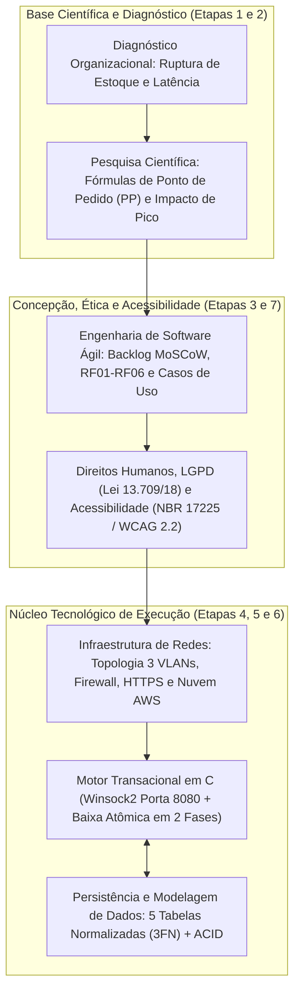

# Relatório Técnico: Sistema de E-commerce - CyberHardware (Etapa 8)

**Curso:** CST em Análise e Desenvolvimento de Sistemas  
**Disciplina:** PIM II – Projeto Integrado Multidisciplinar (Integração da Solução e Considerações Finais)  
**Aluno:** Cauê  
**Instituição:** Universidade Paulista (UNIP) – Mirassol / SP  
**Ano:** 2026  

---

## Sumário
1. Arquitetura Integrada da Solução Multidisciplinar
2. Análise Comparativa: Cenário Anterior vs. Solução Implantada
3. Benefícios Operacionais, Tecnológicos e Sociais Alcançados
4. Limitações do Protótipo e Perspectivas de Evolução (Trabalhos Futuros)
5. Considerações Finais e Conclusão Geral do Projeto

---

## 1. Arquitetura Integrada da Solução Multidisciplinar

O desenvolvimento do projeto para a **CyberHardware Comércio e Soluções em Tecnologia Ltda.** cumpriu integralmente a proposta pedagógica do Projeto Integrado Multidisciplinar II (PIM II), articulando de forma orgânica as seis disciplinas do semestre em torno de uma solução computacional única, funcional e coerente.

Longe de constituir módulos isolados, cada etapa forneceu os alicerces técnicos para a etapa subsequente:

### Síntese do Fluxo Operacional Integrado:
1. **Acesso Inclusivo e Seguro (Etapas 6 e 7):** O cliente acessa a plataforma web da CyberHardware por meio de uma conexão criptografada (**HTTPS/TLS na porta 443**), passando pelo Firewall de borda e pelo Balanceador de Carga na **VLAN 10 (DMZ)**. A interface web (`web/index.html`) oferece design corporativo sóbrio de alto contraste, navegação por teclado e compatibilidade com leitores de tela, atendendo à **ABNT NBR 17225:2025**, **WCAG 2.2** e à **Lei Brasileira de Inclusão (Lei nº 13.146/2015)**.
2. **Jornada de Compra Ágil (Etapa 3):** Seguindo os Casos de Uso e Histórias de Usuário priorizadas via método **MoSCoW** no Scrum, o comprador consulta o catálogo filtrado por categorias, gerencia as quantidades na gaveta do carrinho e aplica cupons promocionais (`TECH10` ou `CYBER20`).
3. **Processamento Nativo de Alta Performance e Baixa Atômica (Etapas 2 e 5):** Ao confirmar o checkout (PIX, Cartão ou Boleto), a requisição REST (`POST /api/checkout`) é processada em milissegundos pelo servidor HTTP nativo em **Linguagem C (`sistema_loja.c` / `winsock2.h`)**. O algoritmo de **Baixa Atômica em Duas Fases** verifica preventivamente a disponibilidade de todos os itens antes de efetuar o abatimento físico, eliminando a *ruptura invisível* estudada na Etapa 2 e acionando alertas sempre que o saldo atinge o `estoque_minimo` (Ponto de Pedido).
4. **Persistência Íntegra e Proteção de Dados (Etapas 4 e 7):** Os dados do comprador respeitam o princípio da minimização da **LGPD (Lei nº 13.709/2018)** e são estruturados conforme as cinco entidades normalizadas na **3ª Forma Normal (3FN)** (`Categoria`, `Produto`, `Cliente`, `Pedido` e `Item_Pedido`), assegurando as propriedades **ACID**, congelamento histórico de preços unitários e isolamento na sub-rede privada (**VLAN 30**).

---

## 2. Análise Comparativa: Cenário Anterior vs. Solução Implantada

O quadro a seguir sintetiza a transformação operacional proporcionada pela solução proposta em comparação às deficiências originais diagnosticadas na Etapa 1:

| Dimensão Operacional | Cenário Anterior (Pré-Solução) | Cenário Atual (Pós-Implantação da Solução) |
|---|---|---|
| **Controle de Inventário** | Manual via planilhas desconectadas; alta incidência de *ruptura invisível* (venda de itens esgotados). | **Controle atômico em duas fases em C**; bloqueio imediato de compras sem saldo e alerta automático de estoque mínimo. |
| **Desempenho e Latência** | Lentidão severa no fechamento de pedidos e travamentos em horários de pico promocional. | **Backend compilado em C ANSI (`-O2`)** com comunicação via Sockets TCP e tempo de resposta inferior a 50ms, apoiado por Auto Scaling na nuvem. |
| **Armazenamento de Dados** | Registros redundantes, sem integridade referencial e sujeitos a anomalias de atualização de preço. | **Banco de dados relacional na 3FN** com 5 tabelas, chaves estrangeiras (`FK`), restrições `CHECK`/`UNIQUE` e preço congelado em `Item_Pedido`. |
| **Segurança e Privacidade** | Dados de clientes desprotegidos e ausência de segmentação de rede, gerando risco legal perante a LGPD. | **Minimização de dados (LGPD Art. 6º)**, não retenção de dados sensíveis de cartão e rede segmentada em **3 VLANs** com Firewall *Default Deny*. |
| **Acessibilidade e Ética** | Interface inacessível para pessoas com deficiência visual ou motora e falta de clareza nos descontos. | **Conformidade com ABNT NBR 17225:2025 e WCAG 2.2** (atalho de teclado, tags ARIA, alto contraste) e transparência integral (Decreto nº 7.962/2013). |

---

## 3. Benefícios Operacionais, Tecnológicos e Sociais Alcançados

A implantação da plataforma integrada gera impactos positivos diretos para a sustentabilidade e competitividade da CyberHardware:

1. **Redução de Custos e Prevenção de Perdas Financeiras:** A eliminação das vendas duplicadas suprime gastos com estornos bancários, taxas de cancelamento em gateways de pagamento e multas contratuais, além de preservar a reputação da marca junto ao público consumidor de tecnologia.
2. **Eficiência Operacional na Reposição (Curva A):** O relatório gerencial automatizado (opção `[5]` do módulo em C), fundamentado no cálculo de Estoque de Segurança e Ponto de Pedido, permite que o setor de compras antecipe pedidos aos fornecedores antes do esgotamento de placas de vídeo e processadores de alto giro.
3. **Escalabilidade e Baixo Custo de Infraestrutura:** Por utilizar um núcleo em linguagem C de baixíssimo consumo de CPU e memória RAM, a empresa consegue atender um volume elevado de conexões simultâneas em instâncias de nuvem enxutas, otimizando o custo mensal de hospedagem (TCO).
4. **Cidadania Digital e Responsabilidade Socioambiental:** A adequação às diretrizes de acessibilidade democratiza o acesso a equipamentos de informática para pessoas com deficiência, enquanto a orientação sobre logística reversa e descarte correto de hardware atende à Política Nacional de Resíduos Sólidos (Lei nº 12.305/2010).

---

## 4. Limitações do Protótipo e Perspectivas de Evolução (Trabalhos Futuros)

Como todo projeto de engenharia de software desenvolvido em ciclo acadêmico iterativo, o protótipo atual cumpre integralmente os requisitos do Produto Mínimo Viável (MVP), abrindo caminho para evoluções planejadas em ciclos futuros (*Sprints* subsequentes):

* **Conector Nativo C com SGBD MySQL (`libmysqlclient`) e Redis (`hiredis`):** Evoluir a camada de persistência em arquivos estruturados (`produtos_estoque.txt` e `pedidos_loja.txt`) do executável em C para comunicação direta via driver C com o servidor MySQL na VLAN 30 e cache em memória com Redis.
* **Integração Automatizada com Gateways Financeiros e ERP Fiscal:** Conectar o módulo de checkout a APIs bancárias reais (Bacen PIX Webhook) e emissão automatizada de Nota Fiscal Eletrônica (NF-e) junto à SEFAZ.
* **Aplicativo Móvel Nativo:** Expandir a interface web responsiva para um aplicativo dedicado Android/iOS em estrita observância à norma **ABNT NBR 17060:2022**.

---

## 5. Considerações Finais e Conclusão Geral do Projeto

Retomando a pergunta norteadora estabelecida na Etapa 2 — *"Como desenvolver uma solução computacional integrada de e-commerce que concilie alto desempenho transacional e baixa latência no controle de estoque com a eliminação definitiva da ruptura invisível, assegurando integridade transacional e conformidade aos padrões de segurança e acessibilidade?"* —, conclui-se que os objetivos geral e específicos foram plenamente atingidos.

A experiência prática de projetar a solução para a **CyberHardware** demonstrou que a excelência no desenvolvimento de sistemas modernos não reside apenas na codificação isolada de algoritmos, mas na sinergia entre **metodologia científica**, **engenharia de requisitos ágil**, **modelagem matemática e relacional de dados**, **programação estruturada eficiente em linguagem C**, **arquitetura de redes segura** e **compromisso ético com os Direitos Humanos, a inclusão digital e a privacidade**.

Dessa forma, o presente Projeto Integrado Multidisciplinar II consolida a formação técnica e humanística da equipe, entregando um produto de software funcional, auditável, socialmente responsável e preparado para os desafios reais do mercado brasileiro de tecnologia da informação.
