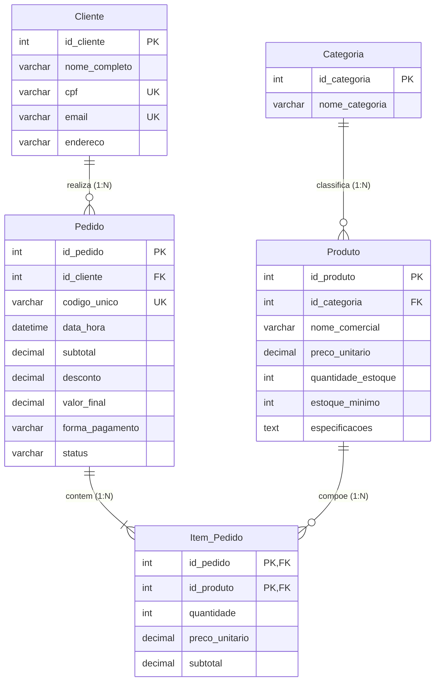

# Relatório Técnico: Sistema de E-commerce - CyberHardware (Etapa 4)

**Curso:** CST em Análise e Desenvolvimento de Sistemas  
**Disciplina:** PIM II – Projeto Integrado Multidisciplinar (Modelagem de Banco de Dados)  
**Aluno:** Saullo  
**Instituição:** Universidade Paulista (UNIP) – Mirassol / SP  
**Ano:** 2026  

---

## Sumário
1. Modelagem Conceitual: Entidades e Atributos
2. Modelo Lógico e Normalização
3. Modelo Físico: Scripts SQL (DDL e DML)
4. Estudo Comparativo: SQL Relacional vs. NoSQL Complementar

---

## 1. Modelagem Conceitual: Entidades e Atributos

O sistema de e-commerce da **CyberHardware** foi estruturado com base em cinco entidades fundamentais, garantindo a cobertura completa das operações comerciais, controle rigoroso de estoque, conformidade fiscal (LGPD) e rastreabilidade de vendas. Abaixo estão detalhadas as entidades, seus atributos e regras estruturais:

* **CATEGORIA:** Agrupa os tipos de componentes comercializados, como Placas de Vídeo, Processadores e Periféricos. Os atributos incluem o identificador da categoria (chave primária) e o nome/descrição da categoria.
* **PRODUTO:** Representa o hardware disponibilizado no catálogo da loja. Os campos englobam o identificador do produto (chave primária), nome comercial, preço unitário, saldo atual de estoque, estoque mínimo de alerta, especificações técnicas e o identificador da categoria (chave estrangeira).
* **CLIENTE:** Gerencia o cadastro dos compradores para fins de entrega e conformidade fiscal (LGPD). Seus atributos são o identificador do cliente (chave primária), nome completo, CPF (único), e-mail (único) e endereço de entrega.
* **PEDIDO:** Representa o cabeçalho da transação comercial concluída. Os campos contêm o identificador do pedido (chave primária), código único amigável (ex: `PED-00001`), data/hora, subtotal, desconto de cupom, valor total faturado, forma de pagamento (PIX, Cartão ou Boleto), status e o identificador do cliente associado (chave estrangeira).
* **ITEM_PEDIDO:** Entidade associativa necessária para detalhar os múltiplos hardwares comprados em uma única venda, resolvendo a relação `N:N` entre `Produto` e `Pedido`. Os atributos são o identificador do pedido (chave estrangeira), identificador do produto (chave estrangeira), quantidade comprada, preço unitário (congelado na data da venda) e o subtotal do item.

### Figura 1 – Diagrama Entidade-Relacionamento (DER) do Sistema CyberHardware



---

## 2. Modelo Lógico e Normalização

A modelagem de dados do sistema CyberHardware foi desenvolvida respeitando rigorosamente as regras de normalização para garantir a integridade das informações, otimizar o armazenamento e evitar anomalias de atualização, inserção e exclusão. Abaixo está a fundamentação de como o modelo atende às três formas normais:

### Primeira Forma Normal (1FN)
A 1FN determina que as tabelas não podem conter atributos multivalorados ou grupos repetidos, devendo armazenar valores atômicos. No contexto do sistema, existia uma relação original de Muitos-para-Muitos (`N:N`) entre `Pedido` e `Produto`, visto que um pedido contém vários produtos diferentes e o mesmo produto figura em diversos pedidos de clientes distintos. Manter essa relação diretamente no modelo lógico geraria redundância de dados e violaria a 1FN. A solução adotada foi criar a entidade associativa `Item_Pedido`, quebrando a cardinalidade `N:N` em dois relacionamentos de Um-para-Muitos (`1:N`): um de `Pedido` para `Item_Pedido` e outro de `Produto` para `Item_Pedido`.

### Segunda Forma Normal (2FN)
Para estar na 2FN, o modelo deve atender à 1FN e garantir que todos os atributos não-chave dependam integralmente da chave primária inteira (especialmente em tabelas com chaves compostas). Na tabela associativa `Item_Pedido` — cuja chave primária é composta por `(id_pedido, id_produto)` —, atributos como a quantidade comprada, o preço unitário congelado e o subtotal dependem exclusivamente da combinação entre o produto e o pedido. Informações exclusivas do hardware comercializado (como nome comercial, saldo de estoque e especificações técnicas) dependem apenas do identificador do produto e, por isso, permanecem isoladas na tabela `Produto`.

### Terceira Forma Normal (3FN)
A 3FN exige que a estrutura atenda à 2FN e elimine as dependências transitivas, ou seja, atributos não-chave não podem depender de outros atributos não-chave. O banco de dados obedece a essa regra ao separar os agrupamentos de entidades de forma lógica. Por exemplo, os dados fiscais e de entrega (CPF, e-mail e endereço) ficam estritamente na tabela `Cliente`, migrando apenas o `id_cliente` como chave estrangeira para o cabeçalho do `Pedido`. O mesmo conceito foi aplicado à tabela `Categoria`, garantindo que os tipos de componentes agrupem os itens enviando a chave estrangeira para `Produto` sem repetir o nome da categoria. Como reflexo prático de uma arquitetura normalizada que atende às regras de negócio, o preço de venda é copiado e congelado dentro de `Item_Pedido`. Isso evita que o histórico financeiro dependa transitivamente do catálogo atual, assegurando que pedidos passados não sejam alterados se a loja reajustar o preço da peça no futuro.

---

## 3. Modelo Físico: Scripts SQL (DDL e DML)

O script DDL a seguir estabelece a criação das tabelas, chaves primárias, chaves estrangeiras e restrições de integridade (`CHECK` e `UNIQUE`), seguido pelo script DML populando dados iniciais de teste integrados ao catálogo do sistema em C.

```sql
-- =====================================================================
-- 1. CRIAÇÃO DAS TABELAS E REGRAS DE INTEGRIDADE (DDL)
-- =====================================================================

CREATE TABLE Categoria (
    id_categoria INT PRIMARY KEY AUTO_INCREMENT,
    nome_categoria VARCHAR(100) NOT NULL
);

CREATE TABLE Produto (
    id_produto INT PRIMARY KEY AUTO_INCREMENT,
    id_categoria INT NOT NULL,
    nome_comercial VARCHAR(150) NOT NULL,
    preco_unitario DECIMAL(10, 2) NOT NULL CHECK (preco_unitario > 0),
    quantidade_estoque INT NOT NULL CHECK (quantidade_estoque >= 0),
    estoque_minimo INT NOT NULL,
    especificacoes TEXT,
    FOREIGN KEY (id_categoria) REFERENCES Categoria(id_categoria)
);

CREATE TABLE Cliente (
    id_cliente INT PRIMARY KEY AUTO_INCREMENT,
    nome_completo VARCHAR(150) NOT NULL,
    cpf VARCHAR(14) NOT NULL UNIQUE,
    email VARCHAR(100) NOT NULL UNIQUE,
    endereco VARCHAR(255) NOT NULL
);

CREATE TABLE Pedido (
    id_pedido INT PRIMARY KEY AUTO_INCREMENT,
    id_cliente INT NOT NULL,
    codigo_unico VARCHAR(20) NOT NULL UNIQUE,
    data_hora DATETIME NOT NULL,
    subtotal DECIMAL(10, 2) NOT NULL,
    desconto DECIMAL(10, 2) DEFAULT 0,
    valor_final DECIMAL(10, 2) NOT NULL,
    forma_pagamento VARCHAR(50) NOT NULL,
    status VARCHAR(50) NOT NULL,
    FOREIGN KEY (id_cliente) REFERENCES Cliente(id_cliente)
);

CREATE TABLE Item_Pedido (
    id_pedido INT NOT NULL,
    id_produto INT NOT NULL,
    quantidade INT NOT NULL CHECK (quantidade > 0),
    preco_unitario DECIMAL(10, 2) NOT NULL CHECK (preco_unitario > 0),
    subtotal DECIMAL(10, 2) NOT NULL,
    PRIMARY KEY (id_pedido, id_produto),
    FOREIGN KEY (id_pedido) REFERENCES Pedido(id_pedido),
    FOREIGN KEY (id_produto) REFERENCES Produto(id_produto)
);

-- =====================================================================
-- 2. INSERÇÃO DE DADOS PARA TESTE (DML)
-- =====================================================================

INSERT INTO Categoria (nome_categoria) VALUES 
('Placas de Vídeo'), 
('Processadores'), 
('Periféricos'),
('Monitores'),
('Armazenamento');

INSERT INTO Produto (id_categoria, nome_comercial, preco_unitario, quantidade_estoque, estoque_minimo, especificacoes) VALUES 
(1, 'Placa de Vídeo RTX 4080 Super 16GB', 7299.90, 5, 2, '16GB GDDR6X | 256-bit | Tri-Fan'),
(2, 'Processador AMD Ryzen 7 7800X3D', 2899.00, 8, 3, '8 Cores / 16 Threads | 104MB Cache'),
(3, 'Teclado Mecânico RGB Switch Red', 349.90, 15, 5, 'ABNT2 | Anti-Ghosting | Switch Linear'),
(3, 'Mouse Gamer Sem Fio 26000 DPI', 299.90, 12, 4, 'Sensor Óptico 26K | Peso 58g'),
(4, 'Monitor Gamer 27" IPS 165Hz 1ms', 1499.00, 6, 2, '27 pol | Painel IPS | 165Hz'),
(5, 'SSD NVMe M.2 2TB Gen4 7000MB/s', 899.90, 10, 3, 'PCIe 4.0 | Leitura 7000MB/s');

INSERT INTO Cliente (nome_completo, cpf, email, endereco) VALUES 
('Carlos Almeida', '123.456.789-00', 'carlos.almeida@email.com', 'Rua das Orquídeas, 50'),
('Mariana Souza', '987.654.321-11', 'mariana.souza@email.com', 'Av. Brasil, 1500');

INSERT INTO Pedido (id_cliente, codigo_unico, data_hora, subtotal, desconto, valor_final, forma_pagamento, status) VALUES 
(1, 'PED-00001', '2026-11-02 09:15:00', 7299.90, 0.00, 7299.90, 'PIX', 'Faturado'),
(2, 'PED-00002', '2026-11-02 11:30:00', 2899.00, 289.90, 2609.10, 'Cartão de Crédito', 'Aprovado');

INSERT INTO Item_Pedido (id_pedido, id_produto, quantidade, preco_unitario, subtotal) VALUES 
(1, 1, 1, 7299.90, 7299.90),
(2, 2, 1, 2899.00, 2899.00);
```

---

## 4. Estudo Comparativo: SQL Relacional vs. NoSQL Complementar

Para o desenvolvimento do e-commerce da CyberHardware, a escolha da arquitetura de base de dados deve ponderar a natureza crítica das operações financeiras e de inventário em contraponto à flexibilidade de performance exigida pela interface web.

### Por que o Banco Relacional (SQL) é Ideal para o Core de Vendas?
O sistema de e-commerce lida com transações financeiras, controle estrito de saldo em estoque e dados sensíveis de clientes regulados pela LGPD. Nesse cenário, o banco de dados relacional (SQL) é indispensável devido às seguintes garantias:
* **Propriedades ACID (Atomicidade, Consistência, Isolamento e Durabilidade):** Em uma venda, se o cliente compra um componente de hardware, o sistema precisa garantir que o pagamento seja processado, o valor final seja debitado e a baixa no estoque ocorra de maneira atômica. Se qualquer etapa falhar, toda a transação é revertida, impedindo inconsistências como "vender um produto que não tem estoque".
* **Integridade Referencial e Restrições:** O uso de chaves estrangeiras (`FK`), restrições de unicidade (`UNIQUE` para CPF e e-mail) e validações de preço e estoque (`CHECK`) asseguram que o banco rejeite dados corrompidos ou inválidos diretamente na camada de persistência.
* **Histórico Financeiro e Fiscal:** O congelamento do preço unitário na tabela `Item_Pedido` garante a imutabilidade das notas fiscais e auditorias passadas, mesmo que o catálogo sofra reajustes de preço futuros.

### Proposta de Utilização Complementar de NoSQL na CyberHardware
Apesar da robustez relacional para as vendas, a CyberHardware pode se beneficiar do uso complementar de tecnologias NoSQL (como **Redis** ou **MongoDB**) para otimizar pontos específicos da arquitetura da aplicação:
* **Uso do Redis (Banco de Dados Chave-Valor em Memória):** Ideal para gerenciar as sessões ativas dos usuários e o carrinho de compras temporário na interface SPA. Como o Redis opera inteiramente na memória RAM, a leitura e a gravação de itens adicionados ao carrinho antes do checkout ocorrem de forma extremamente rápida, aliviando o banco de dados relacional de requisições transacionais de alta frequência e baixa criticidade.
* **Uso do MongoDB (Banco Orientado a Documentos):** Perfeito para estruturar o catálogo dinâmico de produtos da CyberHardware. Como os hardwares comercializados possuem especificações técnicas altamente variadas (ex: uma placa de vídeo possui clock, barramentos e tecnologias específicas que diferem totalmente de um processador ou de um periférico), um banco NoSQL em documentos JSON flexíveis permitiria armazenar essas fichas técnicas sem a necessidade de centenas de colunas vazias ou tabelas de atributos complexas.

### Conclusão da Arquitetura
A CyberHardware adota uma estratégia híbrida e madura de mercado: o banco relacional (MySQL) atua como a "âncora de segurança" para clientes, pedidos, pagamentos e o inventário crítico (garantindo ACID), enquanto soluções NoSQL entram como suporte de alta performance para o cache de sessões, carrinho rápido e flexibilidade no catálogo do e-commerce.
