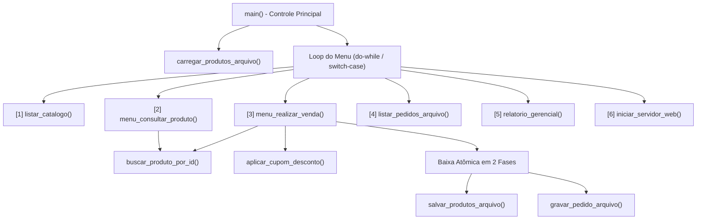
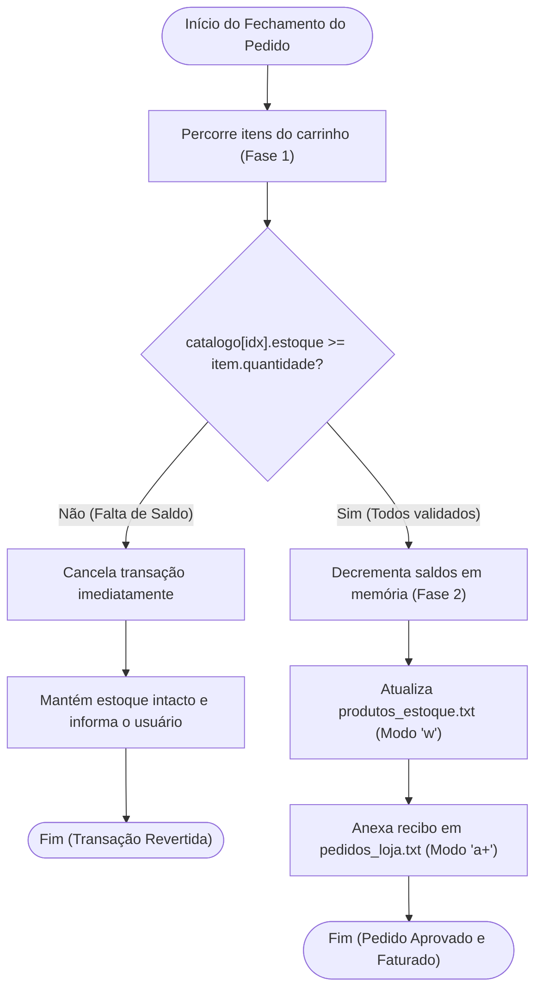

# Relatório Técnico: Sistema de E-commerce - CyberHardware (Etapa 5)

**Curso:** CST em Análise e Desenvolvimento de Sistemas  
**Disciplina:** PIM II – Projeto Integrado Multidisciplinar (Programação Estruturada em C)  
**Aluno:** Vittor Salvador  
**Instituição:** Universidade Paulista (UNIP) – Mirassol / SP  
**Ano:** 2026  

---

## Sumário
1. Introdução e Contextualização do Módulo em C
2. Modelagem das Estruturas de Dados (`struct`)
3. Modularização e Arquitetura de Funções
4. Algoritmo Crítico: Baixa Atômica de Estoque em Duas Fases
5. Persistência de Dados em Arquivos (`FILE*`)
6. Integração Cliente-Servidor: Sockets TCP (`winsock2.h`) e Interface Web Sóbria
7. Instruções de Compilação, Execução e Evidências de Teste

---

## 1. Introdução e Contextualização do Módulo em C

O presente documento especifica a arquitetura, a lógica algorítmica e a implementação do motor transacional desenvolvido em **Linguagem C ANSI/ISO** para a **CyberHardware Comércio e Soluções em Tecnologia Ltda.**, cumprindo os requisitos da disciplina de **Programação Estruturada em C**.

Conforme diagnosticado na Etapa 1 e fundamentado cientificamente na Etapa 2, a operação da empresa enfrentava três problemas centrais:
1. **Ruptura Invisível de Estoque:** Venda acidental de componentes sem saldo físico real no armazém por ausência de trava transacional imediata.
2. **Lentidão no Fechamento de Pedidos:** Falta de automação no cálculo de subtotais, aplicação de cupons promocionais e emissão de comprovantes.
3. **Vulnerabilidade de Persistência:** Ausência de registros estruturados em disco para auditoria contábil e conferência de estoque mínimo (Ponto de Pedido).

Para solucionar esses gargalos com máxima eficiência computacional e consumo mínimo de memória RAM, o sistema foi construído em linguagem C estruturada, operando de forma integrada em **duas frentes**:
* **Interface de Console Interativa (Terminal ABNT):** Menu administrativo completo baseado em estruturas de repetição (`do-while`), seleção condicional (`switch/case`), manipulação de ponteiros e relatórios tabulares.
* **Servidor HTTP Nativo via Sockets (`winsock2.h`):** Módulo de rede integrado na porta `8080` que serve uma interface web corporativa sóbria e responsiva, processando compras em tempo real via requisições REST.

---

## 2. Modelagem das Estruturas de Dados (`struct`)

Em consonância direta com a Modelagem de Banco de Dados (Etapa 4 – Saullo), o domínio de dados em memória foi estruturado através de quatro registros compostos (`typedef struct`), garantindo correspondência direta entre os atributos manipulados pelo código em C e as tabelas do modelo relacional (`Categoria`, `Produto`, `Cliente`, `Pedido` e `Item_Pedido`):

```c
// 1. Representação em memória da entidade PRODUTO (e vínculo com CATEGORIA)
typedef struct {
    int id;                     // Identificador único do produto (PK)
    char nome[80];              // Nome comercial do hardware
    char categoria[40];         // Categoria associada (Placas de Vídeo, Processadores, etc.)
    double preco;               // Preço unitário de venda (R$)
    double preco_antigo;        // Preço anterior para referência comercial
    int estoque;                // Quantidade física disponível (CHECK >= 0)
    int estoque_minimo;         // Ponto de pedido para alerta de reposição
    char specs[80];             // Especificações técnicas do componente
    char badge[30];             // Classificação comercial
} Produto;

// 2. Representação em memória da entidade associativa ITEM_PEDIDO
typedef struct {
    int id_produto;             // Referência ao código do produto (FK)
    int quantidade;             // Quantidade adquirida (CHECK > 0)
    double preco_unitario;      // Preço unitário congelado no ato da venda
    double subtotal;            // Valor calculado (quantidade * preco_unitario)
} ItemCarrinho;

// 3. Representação em memória da entidade CLIENTE (Conformidade LGPD)
typedef struct {
    char nome[80];              // Nome completo do comprador
    char cpf[16];               // CPF único para emissão fiscal
    char email[80];             // E-mail para envio de comprovante
    char endereco[120];         // Endereço completo de entrega
} Cliente;

// 4. Representação em memória da entidade PEDIDO
typedef struct {
    int id_pedido;              // Identificador sequencial interno (PK)
    char codigo_pedido[32];     // Código único amigável (ex: PED-00001)
    Cliente cliente;            // Dados do cliente vinculado
    ItemCarrinho itens[10];     // Lista de itens que compõem o pedido
    int total_itens;            // Quantidade de itens distintos no pedido
    double valor_bruto;         // Soma bruta dos subtotais
    double desconto;            // Valor abatido por cupom promocional
    double valor_total;         // Valor líquido final faturado
    char forma_pagamento[30];   // PIX, Cartão de Crédito ou Boleto Bancário
    char data_hora[30];         // Registro temporal da transação (time.h)
} Pedido;
```

---

## 3. Modularização e Arquitetura de Funções

O código-fonte ([`sistema_loja.c`](file:///c:/Users/vitin/OneDrive/Documentos/_PIM_II_UNIP_/sistema_loja.c)) foi projetado segundo o princípio de **modularização funcional**, dividindo o sistema em sub-rotinas coesas e independentes:



### Resumo Técnico das Funções Implementadas:

| Função | Parâmetros e Retorno | Responsabilidade Técnica |
|---|---|---|
| `carregar_produtos_arquivo()` | `(Produto catalogo[]) -> int` | Lê `produtos_estoque.txt` na inicialização; caso não exista, gera a base padrão. |
| `salvar_produtos_arquivo()` | `(Produto catalogo[], int total) -> int` | Persiste imediatamente em disco qualquer atualização de saldo de estoque. |
| `buscar_produto_por_id()` | `(Produto catalogo[], int total, int id) -> int` | Algoritmo de busca sequencial; retorna o índice no vetor ou `-1` se inexistente. |
| `aplicar_cupom_desconto()` | `(const char *cupom, double bruto) -> double` | Valida cupons via `strcmp()` (`TECH10` = 10%, `CYBER20` = 20%) e retorna o desconto. |
| `menu_realizar_venda()` | `(Produto[], int, int *pedidos, double *fat)` | Conduz o fluxo de compra, aplicando passagem por referência (ponteiros) e baixa atômica. |
| `gravar_pedido_arquivo()` | `(Pedido *p, Produto[], int total) -> int` | Registra o comprovante fiscal em `pedidos_loja.txt` utilizando modo append (`"a+"`). |
| `relatorio_gerencial()` | `(Produto[], int, int pedidos, double fat)` | Exibe o faturamento acumulado e identifica produtos com estoque $\le$ estoque mínimo. |
| `iniciar_servidor_web()` | `(Produto[], int, int *pedidos, double *fat)` | Inicializa socket TCP na porta `8080` e processa requisições REST (`GET` e `POST`). |

---

## 4. Algoritmo Crítico: Baixa Atômica de Estoque em Duas Fases

Para atender às propriedades de **Atomicidade e Consistência** (destacadas nas Etapas 2 e 4), o fechamento de pedidos — tanto no terminal quanto via requisição web — executa uma rotina de validação em **duas etapas distintas**:

1. **Fase 1 (Pré-validação Preventiva):** O algoritmo percorre todos os itens do carrinho verificando se `catalogo[idx].estoque >= item.quantidade`. Se **qualquer** item apresentar saldo insuficiente, a operação é imediatamente abortada sem alterar nenhuma posição de memória.
2. **Fase 2 (Efetivação e Persistência):** Somente após confirmar a disponibilidade de 100% dos itens da cesta, o sistema executa o decremento (`catalogo[idx].estoque -= quantidade`), atualiza o arquivo físico de estoque e emite o comprovante do pedido.



---

## 5. Persistência de Dados em Arquivos (`FILE*`)

O sistema implementa persistência contínua em disco por meio da biblioteca padrão `<stdio.h>`, operando sobre dois arquivos estruturados:

* **`produtos_estoque.txt` (Modo `"w"` e `"r"`):** Armazena os registros de produtos separados por ponto-e-vírgula (`ID;NOME;CATEGORIA;PRECO;PRECO_ANTIGO;ESTOQUE;ESTOQUE_MINIMO;SPECS;BADGE`). Na leitura, utiliza `fgets()` combinado ao tokenizador `strtok()` e às funções de conversão numérica `atoi()` e `atof()`.
* **`pedidos_loja.txt` (Modo `"a+"`):** Atua como livro-razão de vendas (*log* transacional). O modo `"a+"` garante que novos pedidos sejam sempre adicionados ao final do arquivo, preservando todo o histórico anterior para auditoria na opção `[4]` do sistema.

---

## 6. Integração Cliente-Servidor: Sockets TCP (`winsock2.h`) e Interface Web Sóbria

Na opção **`[6]`** do menu principal, o software em C inicializa a biblioteca `ws2_32.lib` e atua como um servidor HTTP/1.1 completo na porta `8080`, conectando-se diretamente aos conceitos de Redes de Computadores (Etapa 6 – Vitor Godoy):

* **`GET /`:** Lê e entrega a interface web corporativa ([`web/index.html`](file:///c:/Users/vitin/OneDrive/Documentos/_PIM_II_UNIP_/web/index.html)), projetada com visual institucional sóbrio (paleta neutra corporativa em tons *slate* e azul marinho, alto contraste legível WCAG 2.1 AA e navegação por teclado).
* **`GET /api/produtos`:** Serializa o vetor `Produto catalogo[]` da memória do C em uma estrutura JSON padronizada, exibindo preços e saldos em tempo real no navegador.
* **`POST /api/checkout`:** Recebe o payload JSON do pedido web, executa a validação atômica de estoque em duas fases no C, persiste a baixa em disco e retorna o número do pedido faturado (`PED-XXXXX`).

---

## 7. Instruções de Compilação, Execução e Evidências de Teste

### Compilação via GCC (MinGW x64):
```cmd
gcc -Wall -O2 sistema_loja.c -o sistema_loja.exe -lws2_32 -lshell32
```
Ou através da execução direta do automatizador [**`EXECUTAR_SISTEMA_C.bat`**](file:///c:/Users/vitin/OneDrive/Documentos/_PIM_II_UNIP_/EXECUTAR_SISTEMA_C.bat).

### Exemplo de Comprovante Emitido e Persistido pelo Sistema (`pedidos_loja.txt`):
```text
======================================================================
COMPROVANTE DE PEDIDO: PED-00001
DATA / HORA          : 01/11/2026 03:43:58
CLIENTE              : Vittor Salvador (CPF: 123.456.789-00)
PAGAMENTO            : PIX
----------------------------------------------------------------------
ITENS DO PEDIDO:
  - 1x Placa de Video RTX 4080 Super 16GB     (Un: R$  7299,90 | Subtotal: R$  7299,90)
----------------------------------------------------------------------
SUBTOTAL BRUTO       : R$ 7299,90
DESCONTO APLICADO    : R$ 0,00
TOTAL FINAL FATURADO : R$ 7299,90
STATUS               : APROVADO / ESTOQUE ATUALIZADO
======================================================================
```
