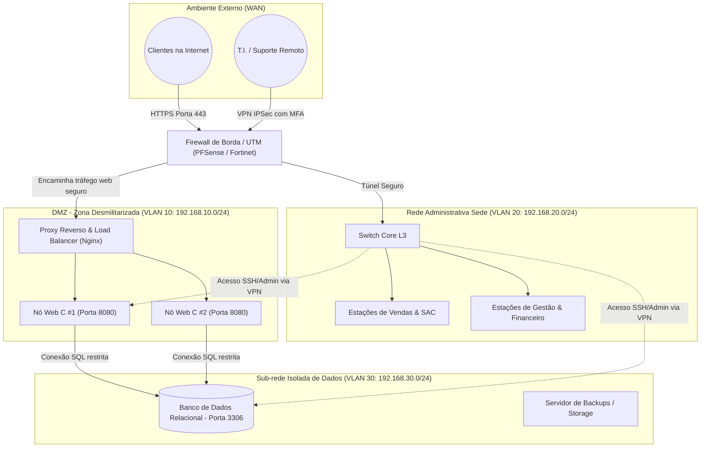

# ETAPA 6: REDES E SISTEMAS DISTRIBUÍDOS — PARTE 2: GABARITO DE REFERÊNCIA E PROJETO COMPLETO
**Destinatário:** Vitor Godoy (Gabarito / Solução de Referência da Etapa 6)  
**Projeto:** PIM II – CST em Análise e Desenvolvimento de Sistemas (UNIP 2026/2)  
**Organização:** CyberHardware Comércio e Soluções em Tecnologia Ltda.  
**Objetivo deste Documento:** Disponibilizar o diagrama de topologia visual, tabelas de IPs e VLANs, regras de firewall e arquitetura de nuvem já testadas e integradas ao sistema.

---

## 🗺️ 1. Diagrama de Topologia da Rede Corporativa (Mermaid)

Você pode visualizar este diagrama diretamente ou exportar para imagem/desenhar no Cisco Packet Tracer ou Draw.io:

---

## 🔢 2. Tabela de Endereçamento IP e Segmentação em VLANs

| Segmento / VLAN | Faixa de Rede (CIDR) | Gateway | Máscara de Sub-rede | Finalidade Operacional |
|---|:---:|:---:|:---:|---|
| **VLAN 10 (DMZ / Web)** | `192.168.10.0/24` | `192.168.10.1` | `255.255.255.0` | Servidores HTTP/REST em C e balanceador de carga público. |
| **VLAN 20 (Corporativa)** | `192.168.20.0/24` | `192.168.20.1` | `255.255.255.0` | Estações de trabalho dos colaboradores na sede (Av. Paulista). |
| **VLAN 30 (Dados)** | `192.168.30.0/24` | `192.168.30.1` | `255.255.255.0` | Servidores SGBD MySQL/PostgreSQL e rotinas de backup diário. |
| **VPN de Gerência** | `10.8.0.0/24` | `10.8.0.1` | `255.255.255.0` | Acesso remoto seguro de administradores e desenvolvedores. |

---

## 🛡️ 3. Tabela de Regras de Firewall (Políticas de Filtragem de Pacotes)

O firewall aplica a política de segurança **Default Deny** (bloqueia tudo o que não estiver explicitamente autorizado):

| Regra ID | Origem | Destino | Porta / Serviço | Protocolo | Ação | Justificativa de Segurança |
|:---:|---|---|:---:|:---:|:---:|---|
| **01** | Qualquer (Internet) | Load Balancer (DMZ) | `443 (HTTPS)` | TCP | **ALLOW** | Acesso público criptografado à loja virtual CyberStore. |
| **02** | Qualquer (Internet) | Load Balancer (DMZ) | `80 (HTTP)` | TCP | **REDIRECT** | Redireciona tráfego inseguro HTTP automaticamente para HTTPS (443). |
| **03** | Qualquer (Internet) | Servidores Web C | `8080 (HTTP)` | TCP | **DENY** | Impede acesso direto ao backend; obriga passagem pelo proxy reverso. |
| **04** | Servidores Web (DMZ) | SGBD (VLAN 30) | `3306 (MySQL)` | TCP | **ALLOW** | Permite que o backend em C consulte estoque e grave pedidos. |
| **05** | Qualquer (Internet) | SGBD (VLAN 30) | Qualquer | Qualquer | **DENY** | Isolamento total do banco de dados contra invasões externas. |
| **06** | Rede Admin (VLAN 20) | DMZ e Dados | `22 (SSH)` | TCP | **ALLOW** | Acesso restrito a administradores autenticados com chave pública e MFA. |

---

## 📡 4. Mapeamento da Pilha TCP/IP no Sistema Desenvolvido

Texto para o capítulo explicando a integração com o software em C:

1. **Camada de Aplicação:** 
   * A aplicação web implementa o protocolo **HTTP/1.1**.
   * O cliente (SPA no navegador) faz chamadas sem estado (*stateless*) via endpoints REST:
     * `GET /api/produtos`: Serializa as structs em JSON e entrega o catálogo.
     * `POST /api/checkout`: Envia o payload da compra para processamento no C.
2. **Camada de Transporte:**
   * Utiliza **TCP (Transmission Control Protocol)** via sockets com a função nativa `socket(AF_INET, SOCK_STREAM, 0)`.
   * O TCP foi mandatório por garantir integridade através de controle de fluxo, retransmissão de pacotes perdidos e *Three-Way Handshake* (SYN $\rightarrow$ SYN-ACK $\rightarrow$ ACK).
3. **Camada de Rede (Internet):**
   * Roteamento baseado em pacotes **IPv4** com cabeçalhos contendo IP de Origem e Destino, TTL (*Time to Live*) e fragmentação.
4. **Camada de Acesso à Rede (Física / Enlace):**
   * Quadros no padrão **Ethernet IEEE 802.3** em cabeamento estruturado Categoria 6 (Cat6) na sede, atingindo vazão nominal de 1 Gbps / 10 Gbps.

---

## ☁️ 5. Arquitetura de Nuvem (Cloud Computing) e Alta Disponibilidade

Para atender aos picos de demanda da loja online (como promoções com cupom `CYBER20`), o projeto prevê a hospedagem em Nuvem Pública (AWS):

1. **Camada Web e Backend:**
   * Instâncias virtuais **Amazon EC2 (t3.medium)** executando o backend compilado em C nativo com baixo overhead de CPU e consumo mínimo de memória RAM.
   * **Auto Scaling Group:** Monitora o uso de CPU. Se a utilização média ultrapassar 70% por 3 minutos consecutivos, o sistema provisiona novas instâncias automaticamente, reduzindo-as quando a carga normalizar.
2. **Distribuição de Carga:**
   * **Application Load Balancer (ALB):** Recebe o tráfego externo HTTPS, realiza a terminação SSL/TLS com certificado digital gratuito emitido pelo *AWS Certificate Manager*, e distribui as requisições entre os nós do servidor em C.
3. **Camada de Dados Gerenciada:**
   * **Amazon RDS (Multi-AZ):** Banco de dados relacional gerenciado com réplica síncrona em outra Zona de Disponibilidade para recuperação imediata em caso de falha de hardware (*Disaster Recovery*).
4. **Proteção de Borda e CDN:**
   * **AWS CloudFront & WAF (Web Application Firewall):** Cache de assets estáticos (imagens e ícones) e mitigação contra ataques distribuídos de negação de serviço (DDoS - Camada 7).
